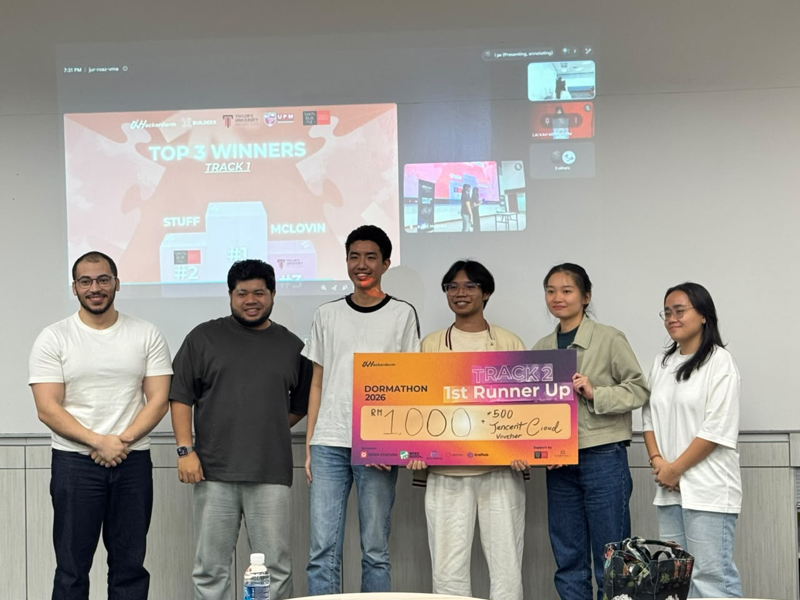

# Lembur

> **Kau tidur, kami lembur.** (You sleep, we do the overtime.)

A back office team in a student's chat app. She sends one message and her receipts before bed. In the morning she gets a payslip that shows what she really earned per hour of her time, and drafts of the changes that would earn her more.

* **First runner up**: Hackerdorm × BuilderX, Track 2 (Agentic Solutions).


* **Presentation slides**: https://canva.link/7ffbzcafv99mk0j
* **Team**: Lawrence Lian Anak Matius Ding, Sharon Lee Jia Yi, Damian Choy Wei-Quan

---

## Docs

* **[Getting started](docs/GETTING_STARTED.md)**: set up, test, run the bot and replay the demo week.
* **[System design](docs/SYSTEM_DESIGN.md)**: the problem, the stack, the layers, the flow, the key decisions and the exact rules.
* **[Evidence of the build](submission/evidence/README.md)**: how WorkBuddy was used.

## How it works

1. **One message before bed**: the student sends the bot a short message with her receipt photos, order screenshots and, on Sunday, her bank statement. She installs nothing.
2. **A plan for the night**: the runner writes down which steps tonight needs and why.
3. **Bookkeeper**: reads the documents, files them and records each transaction.
4. **Reconciliation**: a deterministic tool matches transactions against the bank statement and flags duplicates, gaps and mismatches.
5. **Payroll**: works out the hours from what was sold and what the message says, then the take home and the hourly rate.
6. **Payslip day, Sunday night**: Payroll and the Growth coach argue for opposing changes. The Auditor recomputes the numbers and rules.
7. **Morning**: the bot sends the payslip and the drafted posts and messages waiting for approval.
8. **Loop**: the student replies "approve 2", or replies with a correction that updates the plan for the next night.

## What it does

* **Weekly payslip**: the real hourly rate, in words anyone understands.
* **Hours without a timesheet**: estimated from orders and messages, corrected with one reply.
* **Profit per hour for each product**: shows which product pays and which one costs.
* **Plan versus reality**: every payslip is compared against the plan.
* **Open debate**: agents with conflicting objectives, and an Auditor who rules on the numbers.
* **Drafted actions**: posts and supplier messages are prepared, and nothing is sent without approval.
* **Traceable books**: every ledger row links to the receipt behind it.
* **No estimated numbers**: every figure is calculated by a deterministic tool, never by a model.

## How it is built

* **Three layers**: a Telegram bot, a runner and deterministic tools.
* **Agents act through tools**: each of the four agents works in a short loop. It asks for a tool, the runner runs it, and the agent reads the result and decides the next step.
* **Two model roles**: one model reasons and one reads images. Both come from the model gateway the organisers provided.
* **Standard library only**: Python with no third party package and no agent framework.
* **WorkBuddy is our build platform**: it is not part of the running product.
* **Proved against an answer key**: the demo week replayed through the real models matches the expected ledger and figures with no difference.

## Quick start

```bash
git clone https://github.com/Lawrensu/Lembur.git
```

```bash
cd Lembur
```

* **Run the tests**: no key and no network needed.

```bash
python -B -m unittest discover -s tools/tests -p "test_*.py"
```

* **Run the bot**: copy `.env.example` to `.env`, fill it in, then start it.

```bash
python -B -m app.bot
```

* **Everything else**: [Getting started](docs/GETTING_STARTED.md).

## Repository layout

```
app/            Telegram bot, runner, tool layer, model module and their tests
prompts/        one instruction file per agent
tools/          deterministic tools and their tests
workspace/      one student's files, used by the tests and the demo replay
data/demo/      demo inputs: plan files, inbox files, nightly messages
data/answer_key/    expected ledger and expected figures
data/test_harness/  replay, comparator, reset and mutation test
submission/     payslip template, story notes, evidence of the build
docs/           getting started and system design
```

## Team

* **Lawrence Lian Anak Matius Ding (Law)**: builder. Integration, the runner, the model module and the agent prompts.
* **Sharon Lee Jia Yi**: data and business. The demo dataset, the answer key, the comparator and the tool layer.
* **Damian Choy Wei-Quan**: design and story. The Telegram bot, the agent identities, the payslip template, the deck and the video.

## Repo rules

* **Demo data only**: no real receipts, bank statements or personal details go in this repository.
* **No secrets**: the model key and the bot token live in a `.env` file that git ignores. They never appear in a file, a prompt, a log or a commit.
* **Pull requests go into `dev`**: never into `main`. `main` only receives `dev` after an end to end run.
* **Authors**: the three team members are the only contributors named in commits, files and pull requests. No attribution lines.
* **WorkBuddy is named truthfully**: it is the platform we built with. The docs, slides and video say what it really did, and nothing more.
* **Docs style**: point form, no tables, no dashes in prose.
* **No installs without asking**: a new package or tool needs Law's approval first.
* **Design first**: a change to behaviour or data is written in the system design, then in the code.
